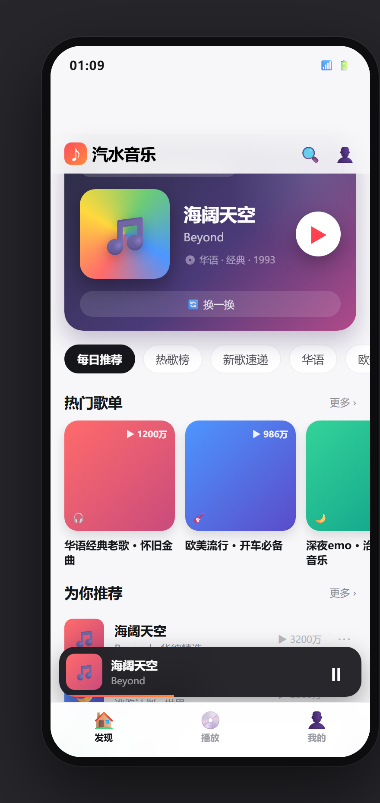

# qMusic · Android 在线音乐播放器

> 参考早期「汽水音乐」界面风格，基于在线音乐资源抓取服务的 Android 音乐播放器。
> 项目包含：高保真原型、设计文档、开发文档、可运行的 Android 工程、音乐抓取服务与交付说明。



---

## 项目亮点

- 🎨 **汽水音乐风格 UI**：浅色发现页 + 深色全屏播放页 + 底部三栏导航 + 歌词视图
- 🌐 **在线音乐资源**：自建 Node 音乐抓取服务（基于 `NeteaseCloudMusicApi`），提供搜索 / 播放地址 / 歌词 / 歌单 / 推荐接口
- 📱 **纯 Kotlin + Jetpack Compose** 实现，MVVM 架构
- ▶️ **Media3 ExoPlayer 播放引擎**，支持前台服务、通知栏进度条控制
- ❤️ **本地收藏 / 最近播放**，Room 持久化
- 🎵 **播放列表弹窗**：队列展示、当前高亮、点击切歌
- 🧩 **桌面小组件**：2x2 播放控制（封面/歌名/播放暂停/上一首/下一首）
- 🌙 **多语言 + 深浅色主题**：中英文案随系统切换；「我的」页深色模式开关持久化
- 🔒 **隐私合规**：首次启动隐私政策弹窗（同意后进入），设置页可随时查看
- 🕘 **真实搜索历史**：本地持久化，支持单条删除与一键清空
- ✨ **Android 12+ Splash 启动页**：品牌色 + 音符图标
- 🔁 **播放模式切换**：顺序播放 / 列表循环 / 单曲循环
- ⏱️ **更多菜单**：分享歌曲、定时关闭（15/30/60 分钟）
- 📚 **全部热门歌单**：发现页「更多 ›」查看并进入任意歌单
- 📁 **本地音乐**：MediaStore 扫描本地音频 + 运行时权限申请，点击本地播放
- 🔒 **R8 混淆 + 资源收缩**：Release APK 仅约 2.5MB
- 🔧 **可一键构建 APK**（Gradle + Android SDK）

## 目录结构

```
qMusic/
├── README.md                    # 项目总览（本文件）
├── docs/
│   ├── 设计文档.md                 # 产品需求 / UI设计 / 视觉规范 / 交互说明
│   ├── 开发文档.md                 # 技术选型 / 系统架构 / 模块设计 / API规格
│   └── 交付说明.md                 # 环境准备 / 构建运行 / 测试 / 部署
├── prototype/
│   ├── index.html                 # 高保真可交互原型（浏览器直接打开）
│   └── screenshots/              # 原型截图（发现/播放/歌词/搜索/我的）
├── server/                       # 音乐抓取服务（Node.js）
│   ├── package.json
│   ├── start.bat / start.sh
│   └── node_modules/              # npm install 后生成（已忽略）
└── android/                       # Android 工程（Kotlin + Compose + Media3）
    └── app/
```

## 快速开始

```bash
# 1) 启动音乐抓取服务（需要 Node.js 16+）
cd server
npm install
npm start          # 监听 http://localhost:3000

# 2) 打开高保真原型
start prototype/index.html        # Windows
open prototype/index.html          # macOS

# 3) 构建 Android APK（需要 JDK17 + Android SDK）
cd android
./gradlew assembleDebug
# 产物：android/app/build/outputs/apk/debug/app-debug.apk
```

> Android 模拟器访问宿主机服务请使用 `http://10.0.2.2:3000`；
> 真机调试请将 `app/src/main/res/xml/network_security_config.xml` 中的 `10.0.2.2` 改为电脑局域网 IP。

## 文档索引

| 文档 | 内容 |
| --- | --- |
| [设计文档](docs/设计文档.md) | 产品定位、需求分析、信息架构、UI/UX 设计、视觉规范、交互流程、原型说明 |
| [开发文档](docs/开发文档.md) | 技术栈、系统架构、模块设计、API 规格、数据模型、构建与测试方案 |
| [交付说明](docs/交付说明.md) | 环境准备、服务端部署、Android 构建运行、真机调试、常见问题、发布清单 |

## Git 提交里程碑

1. `docs: 原型与设计/开发/交付文档`
2. `feat(server): 音乐抓取服务`
3. `feat(android): 工程骨架与架构`
4. `feat(android): 网络层与数据层`
5. `feat(android): 播放服务`
6. `feat(android): UI 页面`
7. `build(android): 产出 APK`
8. `docs: 最终交付说明`
9. `feat(android): 歌单详情页 + 歌词滚动`
10. `feat(android): 播放列表弹窗 + Release 签名`
11. `feat(android): R8 瘦身 / 小组件 / 通知进度 / 歌词调优 / 多语言 / 深浅色`
12. `feat(android): 隐私合规 / 搜索历史持久化 / Splash 启动页 / 设置区`
13. `feat(android): 播放模式 / 分享与定时关闭 / 全部热门歌单 / 我的页滚动定位 / 占位提示`

---

> ⚠️ 版权说明：本项目仅用于学习与技术交流。在线音乐资源来自第三方平台公开接口，请尊重音乐版权，勿将本项目用于商业用途。